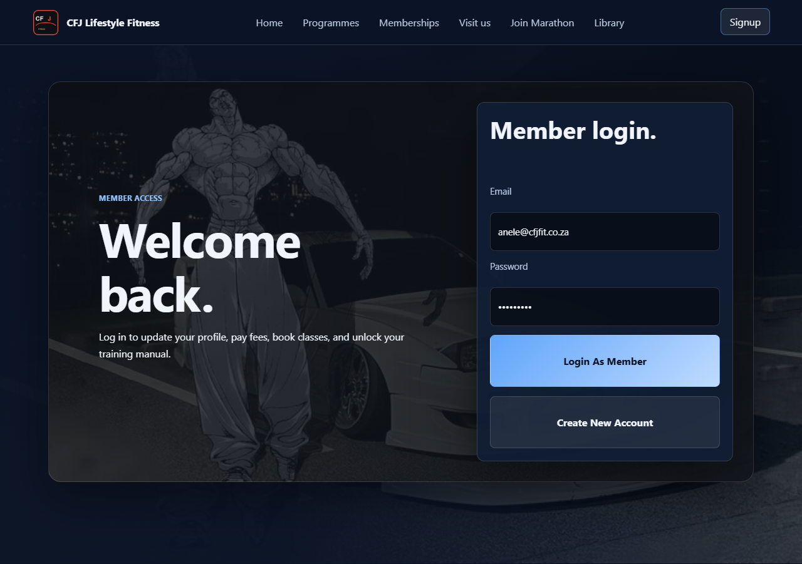
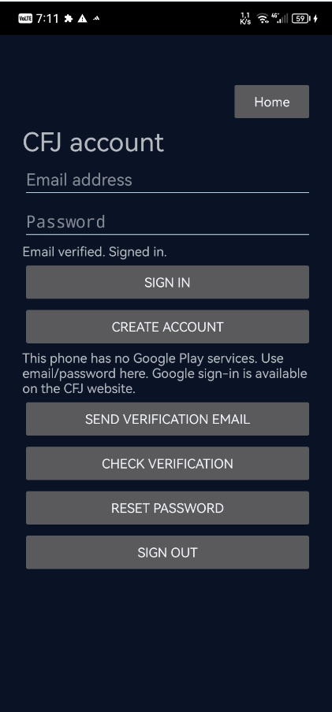
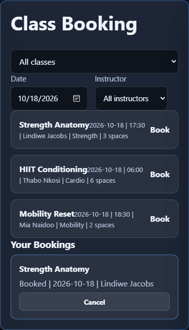
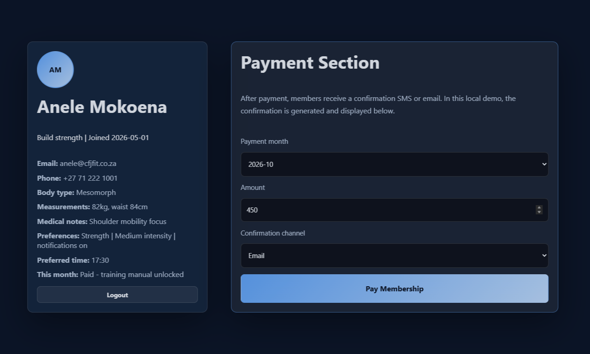
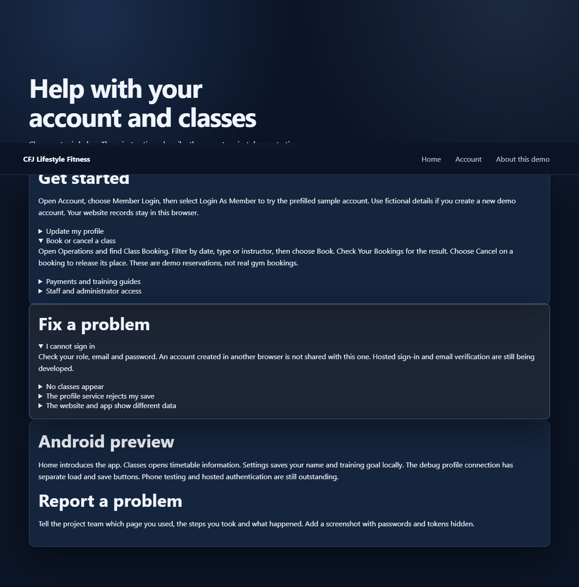
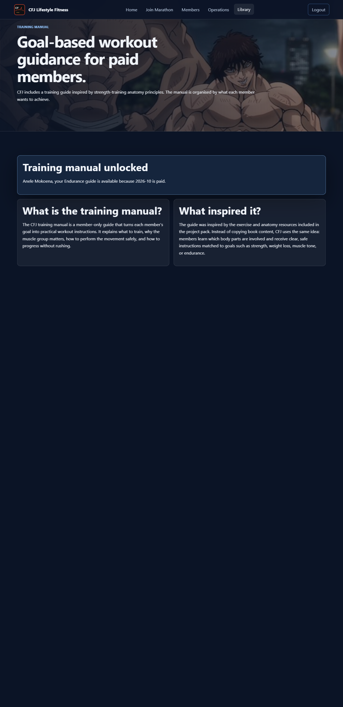

# CFJ Management System — Team Forge

Website and native Kotlin Android application for **CFJ Lifestyle Fitness**, built as the XISD6329 Work-Integrated Learning Task 2 prototype. The website and the Android app both talk to one shared Node.js API, which is the only component that reads and writes the Oracle relational database. Firebase Authentication provides email/password accounts and Google sign-in.

| | |
|---|---|
| **Live website** | https://gym-management-system-11sn.onrender.com/ |
| **Demonstration video** | <!-- REPLACE THIS LINE WITH THE UNLISTED YOUTUBE LINK BEFORE SUBMISSION --> _link to be added before submission_ |
| **Task 2 report** | [docs/report/CFJ_WIL_Task_2_Report.pdf](docs/report/CFJ_WIL_Task_2_Report.pdf) |
| **User guide** | [docs/user-guide/USER_GUIDE.md](docs/user-guide/USER_GUIDE.md) |
| **Evidence index** | [docs/evidence/README_EVIDENCE_INDEX.md](docs/evidence/README_EVIDENCE_INDEX.md) |
| **Tests** | `npm test` — 51 web/API tests; 6 authentication-boundary tests; 16 Android unit tests |
| **Submitted version** | tag `task2-submission` on `main` |

> Academic prototype. All people, bookings, payments and messages are synthetic or simulated. It is not connected to CFJ's operational booking system.

## What the system does

CFJ members can browse programmes and memberships, register and sign in, edit a profile, view classes and book or cancel a place. Staff and administrators get a service desk and aggregate reports. The Android app mirrors the member experience: a training dashboard with three guided exercises and a rest timer, class information, settings and account management.

### Website
- Public home, programmes, memberships, marathon event and help pages.
- Member registration, login, profile editing and booking/cancellation demo.
- Staff service desk: attendance, simulated payments and class operations through the API.
- Admin reports restricted to the admin role.
- Firebase account page for real email/password and Google sign-in (`website/account.html`).
- Help page and illustrated user guide.

### Android app (Kotlin)
- Training dashboard: sit-to-stand, wall press-up and supported calf raise, written technique, sets/reps and a 60-second rest timer, with a locally stored completed-session count.
- Classes screen with the official CFJ timetable link.
- Settings: display name and training goal with validation and reset.
- **CFJ account**: register, email verification, sign in, reset password, sign out, and Google sign-in where Google Play Services are available.
- Debug development panels for the shared API: load/save profile, load memberships and classes, book and cancel a booking.
- Native accessible layout for Android 8.0 (API 26) and later.

### Shared API (Node.js)
- Profile, operations, community, management and public-event routes under `/api/v1`.
- Firebase ID-token verification: signature, expiry, issuer and audience; verified-email requirement; server-side member role; UID mapping to `cfj_members.identity_uid`.
- Booking rules with capacity checks, duplicate prevention, membership eligibility, attendance, simulated payments and idempotent retries.
- Health/readiness endpoint (`/healthz`) for deployment.
- No database credentials are stored in the website or the app.

### Oracle database
- 14 related `cfj_*` tables: members, profiles, memberships, trainers, class sessions, bookings, attendance, payments, trainer requests, friend connections, events, event registrations, resources and messages.
- Primary keys, foreign keys, unique keys, check constraints and indexes (114 constraints verified).
- Repeatable synthetic seed data: 10–20 rows per table (160 rows in total).
- Versioned migrations `001_profiles.sql` to `004_api_retries.sql`; the alternative design study is kept separately under `database/design/alternative-proposal/`.

## Architecture

```
Website (HTML/CSS/JS) ──┐
                        ├── HTTPS + Firebase ID token ──> Node.js API ──> Oracle Database
Android app (Kotlin) ───┘                                      │
                                                               └── Firebase Admin: verify token
Firebase Authentication (email/password + Google) ─────────────┘
```

The API verifies the Firebase token on every protected request and resolves the member from Oracle. Roles and business rules are enforced server-side; hiding a button is not access control.

## Screenshots

| Website | Android app |
|---|---|
|  |  |
|  |  |
|  |  |

## Run the website

```bash
npm start            # local static preview on http://127.0.0.1:8765
```

Open the deployed site at https://gym-management-system-11sn.onrender.com/. The public site uses browser-local demo data unless a page is explicitly connected to the API; the Firebase account page uses the shared identity project.

## Run the API and tests

Requires Node.js 22 or later.

```bash
npm test             # 51 web/API tests
npm run check        # link/asset and script checks for 17 pages
node backend/firebase-oracle-server.mjs   # Firebase-to-Oracle API (needs .env.oracle)
```

The Oracle API requires `ORACLE_USER`, `ORACLE_PASSWORD`, `ORACLE_CONNECT_STRING`, `FIREBASE_PROJECT_ID` and `CFJ_ALLOWED_ORIGINS` in the environment. It binds to `127.0.0.1` by default; set `CFJ_BIND_HOST=0.0.0.0` only behind TLS on a host that keeps its secrets private.

## Run the Android app

```bash
cd mobile-app
./gradlew testDebugUnitTest lintDebug assembleDebug     # Linux/macOS
gradlew.bat testDebugUnitTest lintDebug assembleDebug   # Windows
```

Debug APK: `mobile-app/app/build/outputs/apk/debug/app-debug.apk`.
See [mobile-app/README.md](mobile-app/README.md) for the toolchain, Firebase setup and device instructions.

## Database

```bash
node --env-file=.env.oracle scripts/migrate-oracle.mjs
node --env-file=.env.oracle scripts/seed-oracle.mjs
node --env-file=.env.oracle scripts/verify-oracle-schema.mjs
```

See [database/README.md](database/README.md) and [database/design/](database/design/) for the ERD, data dictionary and transaction design.

## Testing and continuous integration

| Check | Result | Evidence |
|---|---|---|
| Web/API regression suite | 51 passed, 0 failed | `npm test` |
| Firebase authentication boundary | 6 passed | `backend/firebase-gate.test.mjs` |
| Android unit tests | 16 passed | `mobile-app/app/src/test` |
| Android build + lint | build OK, 0 errors, 22 warnings | `docs/evidence/firebase-oracle-2026-10-19/android-build.txt` |
| Website structure | 17 pages passed | `npm run check` |
| GitHub Actions (Android) | success on `12c0312` | [run 39309331362](https://github.com/Manqoba275/CFJ-Management-System/actions/runs/39309331362) |
| GitHub Actions (setup checks) | success on `12c0312` | [run 39309331410](https://github.com/Manqoba275/CFJ-Management-System/actions/runs/39309331410) |

## Evidence

- [Evidence index](docs/evidence/README_EVIDENCE_INDEX.md) — phone, APK, Firebase, database and integration evidence with limitations.
- [WIL verification record](docs/WIL_VERIFICATION_2026-10-18.md) — what was verified and what remains unproven.
- [Release notes](docs/release-notes.md) — dated changes and verification.

## Known limitations

These are stated honestly; they are not claims of completion.

- The API and Oracle database currently run on a development computer, not a public cloud host. The deployed Render site is static. A hosted API/database is required for the final online demonstration.
- Google sign-in was not completed on the available Huawei test phone because it has no Google Play Services; web Google sign-in is implemented but full consent/callback is not yet evidenced.
- The phone screenshot proves the Android account screen ran on a physical phone. A recorded physical-device acceptance run (device model, build hash, install log) is still to be attached.
- Website member flows still use browser-local demo data in places; the Firebase account page is separate from the demo roles.
- Team meetings, Azure DevOps board history and organisation feedback are not represented in this repository.

## Team and contributions

| Member | Role | Main contribution |
|---|---|---|
| Sanele Manqoba Mazibuko | Group leader / lead developer | Integration, shared API, Firebase, Oracle adapters, Android build and release |
| Tshifhiwa Thamagane | Database architect / designer | Schema, migrations, constraints, seed data, class response contract |
| Nyito Ramudzuli | Business analyst | Requirements, acceptance cases, traceability, meeting evidence |
| Nonhlanhla Chirwa | UI/UX designer and tester | Interface review, test cases, defects and acceptance evidence |

Contribution history is in the Git log and pull requests #1–#6. See [CONTRIBUTING.md](CONTRIBUTING.md).

## Documentation

- [User guide](docs/user-guide/USER_GUIDE.md) and [Help page](website/help.html)
- [Implementation plan](docs/IMPLEMENTATION_PLAN.md) and [requirements](docs/REQUIREMENTS.md)
- [Firebase integration](docs/FIREBASE_INTEGRATION.md) and [Firebase to Oracle connection](docs/FIREBASE_ORACLE_CONNECTION.md)
- [Deployment and installation](docs/deployment.md)
- [Release notes](docs/release-notes.md)

---

© 2026 Team Forge. Academic project for The Independent Institute of Education (XISD6329). Not affiliated with CFJ Lifestyle Fitness.