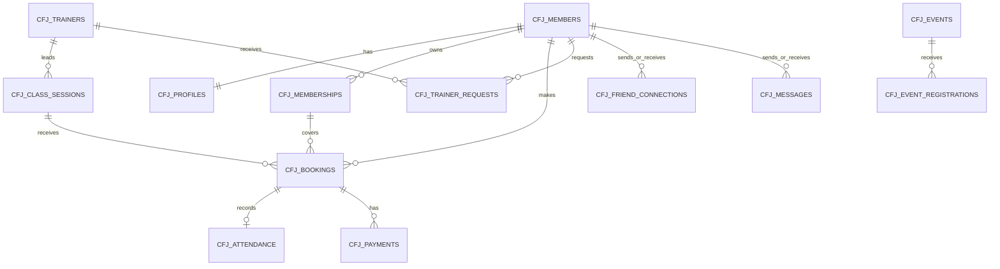

# Relational design and integration boundaries

The schema now contains 14 application tables. `001_profiles.sql` is the original migration; `002_operations.sql` and `003_community.sql` extend it without replacing existing profile data. All data added by `scripts/seed-oracle.mjs` is synthetic.

## Relationships



The member/profile one-to-one relationship is the application expectation; the FK prevents orphan profiles, but a member can temporarily exist without a profile unless both inserts occur in one transaction. Friend connections and messages each have two separate member FKs. Training resources form a catalog; access is checked against the actor's payment/membership state in the API, not through a fabricated FK.

Public event registration deliberately has no member FK: the existing API accepts consenting guests. Payments reference bookings to match the current operations API. These are simulated payment records, not a real processor or billing ledger. Membership plans remain the seven checked plan codes in `backend/membership.mjs`; there is no artificial ten-row plan/role lookup table.

## Rules protected by Oracle

- A booking uses a membership owned by its member (composite FK).
- One member/session booking row; cancellation and rebooking should change this row's status. The existing JSON API instead creates a new row after cancellation: its Oracle adapter must reconcile this difference before integration.
- One attendance record per booking; request IDs prevent repeated attendance/payment inserts.
- Friend pairs are unique regardless of direction. Only the receiving actor may accept a request; the API must enforce that permission.
- Event/email combinations and registration request IDs are unique. Emails must be normalized before insertion, with explicit consent.
- Foreign keys, enumerated states, membership date order and non-negative capacity/positive amounts reject invalid stored data.

## Rules still requiring API integration

The JSON operations API has NOT been replaced by these tables. Capacity limits, membership eligibility, weekly/credit usage, cancellation after attendance, consent/discoverability, role checks, payment retry fingerprints and transactional changes still need Oracle-backed adapters. For a booking, lock the membership and session rows in a consistent order, check eligibility/capacity inside the same transaction, write once, and commit. A session lock alone does not prevent a weekly allowance race across different sessions.

Store instants with time zones; render dates in Africa/Johannesburg. Membership dates are date-only values, bound explicitly with TO_DATE rather than JavaScript timestamp conversion. Keep Firebase UID to member mapping server-side. No password is stored in the business schema.

## Execution

From the repository root with private `.env.oracle` configured:

```powershell
node --env-file=.env.oracle scripts/migrate-oracle.mjs
node --env-file=.env.oracle scripts/seed-oracle.mjs
node --env-file=.env.oracle scripts/verify-oracle-schema.mjs
node --env-file=.env.oracle scripts/verify-oracle-profile.mjs
```

Use the intended test schema, not SYS/SYSTEM. The original two tables must already exist. The additive runner skips existing object names, but that does NOT certify their definitions; inspect the dictionary and constraints if the schema has drifted. Oracle DDL commits immediately. Review errors and existing objects before retrying. Seed DML is one transaction and rolls back on error. A seed rerun inserts missing fixture IDs only, preserving existing values; it is not a reset script.

The reserved member IDs are 9001-9010 with SEED-UID identities. Other fixtures use SEED- IDs. Original members 1-10 are preserved. Fixture dates are fixed historical examples, not live operational membership guarantees. Seed members are not Firebase accounts.

No hosted Oracle migration, backup/recovery success, physical-phone acceptance or team-member review is implied by these scripts. Database engineer verification is separate from Nonhlanhla's assigned acceptance tests and Nyito's assigned progress records.
